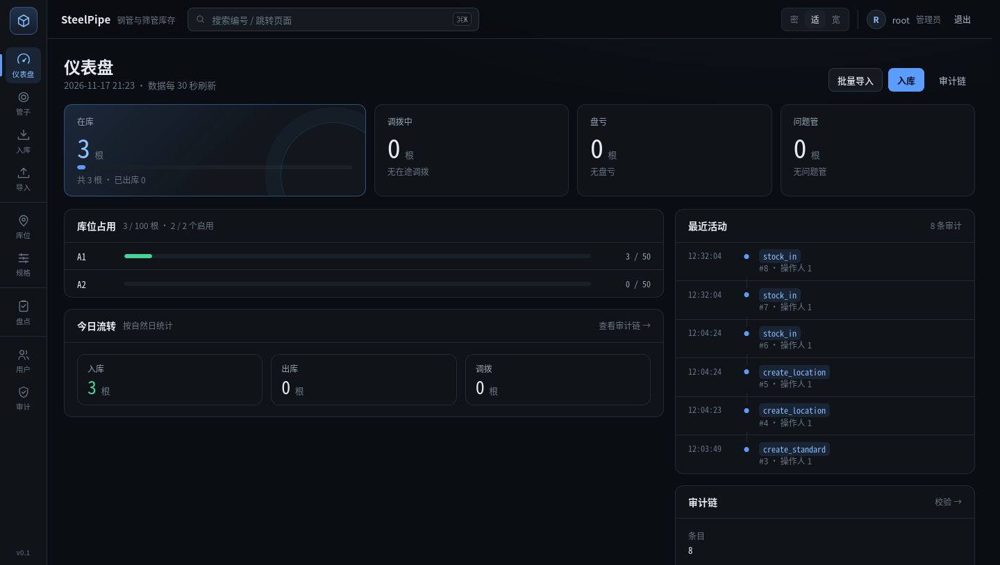
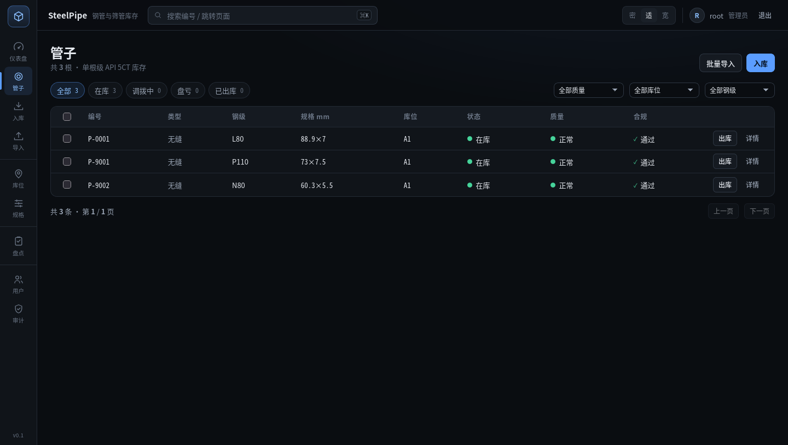
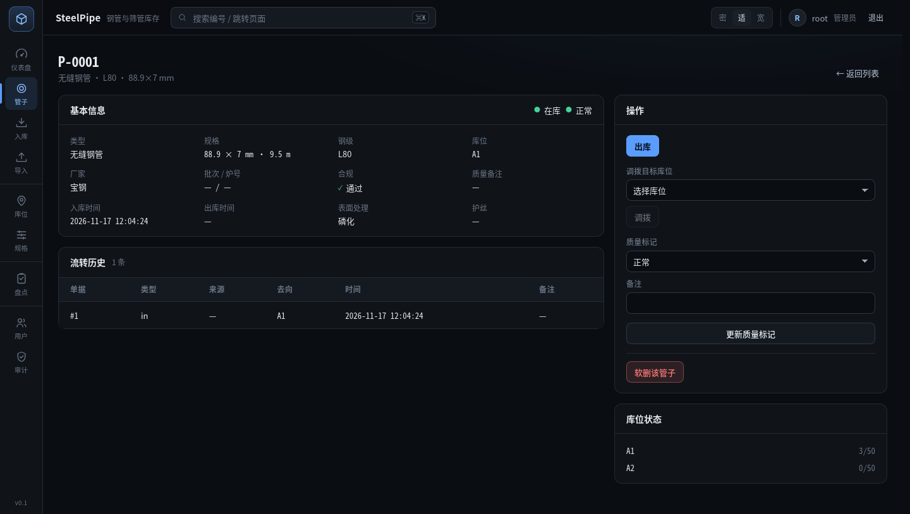
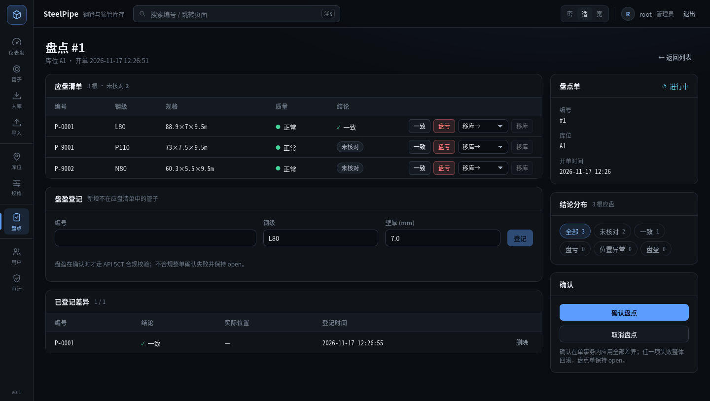
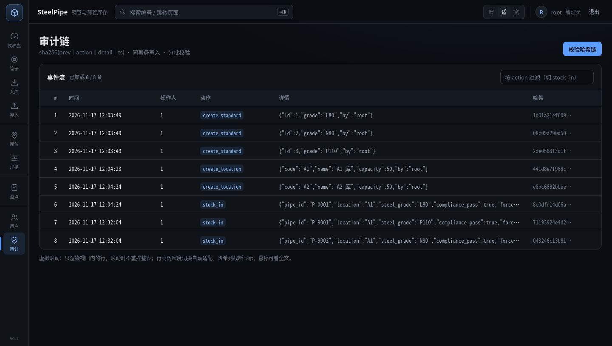
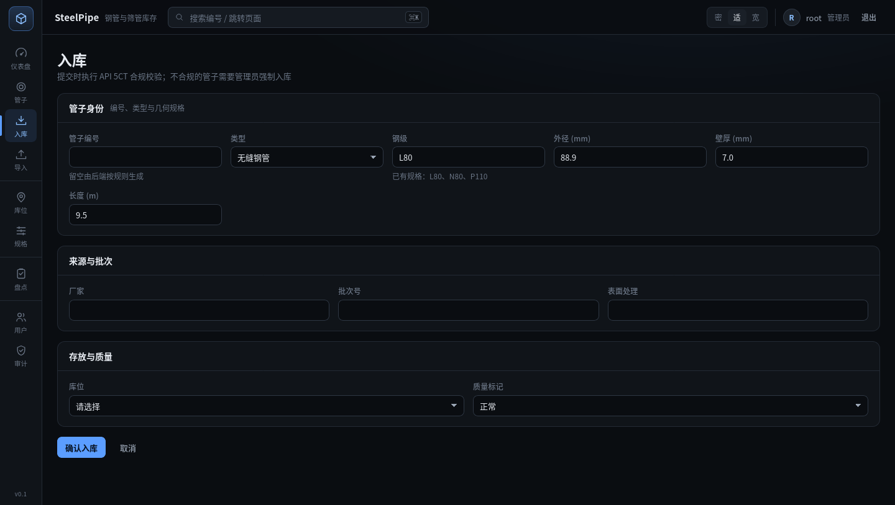

# SteelPipe

[](https://github.com/xiaokonglong123-dot/steel_pipe_db/actions/workflows/ci.yml)
[](https://github.com/xiaokonglong123-dot/steel_pipe_db/releases)
[](https://www.rust-lang.org/)
[](LICENSE)

面向局域网的无缝钢管与筛管单根级库存系统。后端、前端和运维 CLI 集成在一个 `steelpipe` 可执行文件中，数据存储在 SQLite；运行时不需要 Python 或 Node.js。

## 功能

| 领域 | 实现 |
| --- | --- |
| 库存 | 单根入库、单根/批量出库、库位调拨、质量标记、软删除及流转历史 |
| 合规 | 钢级、壁厚、外径、长度与筛管参数校验；管理员可强制入库并留下额外审计 |
| 盘点 | 一致、盘亏、位置异常、盘盈登记；确认时原子应用全部差异；盘亏管可找回 |
| 目录 | 库位与钢级标准规格管理；停用库位不能接收入库或调拨 |
| 审计 | 业务写入与审计同事务提交，SHA-256 哈希链支持分批校验与篡改检测 |
| 导入 | CSV 行级导入，允许部分成功；支持 UTF-8 BOM，单次最多 10,000 行 |
| 用户 | 管理员、操作员、查看者三级权限；密码重置、账号停用、会话吊销 |
| 界面 | 中文暗色 SPA、三档表格密度、筛选排序、命令面板、审计虚拟滚动 |

主要技术栈：Rust 2024、axum、sqlx、SQLite WAL、React、TypeScript、Vite。前端通过 `rust-embed` 在构建后端时内嵌，无需另设静态文件服务。

## 界面预览

| 仪表盘 | 管子列表 |
| --- | --- |
|  |  |

| 管子详情 | 盘点详情 |
| --- | --- |
|  |  |

| 审计链 | 入库 |
| --- | --- |
|  |  |

截图使用本地演示数据。

## 构建与启动

### 环境要求

- Rust stable（含 `rustfmt`、`clippy`），最低版本见 `Cargo.toml` 的 `rust-version`。
- Node.js 22 与 npm，仅用于构建前端。
- Linux + systemd 为当前部署目标；备份恢复脚本还需要 `sqlite3`。

### 本地启动

**先构建前端，再构建后端。** 顺序反过来不会把新前端嵌入二进制。

```bash
cd web
npm ci
npm run build
cd ..

cargo build --release --workspace --bins

export STEELPIPE_JWT_SECRET="$(openssl rand -base64 48)"
export STEELPIPE_DATABASE_URL="sqlite://data/steelpipe.db"
export STEELPIPE_BIND="127.0.0.1:8080"
export STEELPIPE_ADMIN_USERNAME="root"
export STEELPIPE_ADMIN_PASSWORD="请换成至少 8 位的管理员口令"

./target/release/steelpipe serve
```

打开 `http://127.0.0.1:8080`。启动时自动应用数据库迁移；`STEELPIPE_ADMIN_USERNAME` 与 `STEELPIPE_ADMIN_PASSWORD` 同时存在时会创建或重置管理员，**首次登录后应从环境配置中移除这两个变量**。

`STEELPIPE_JWT_SECRET` 为空或短于 32 字节时拒绝启动。生产环境应使用随机生成的独立密钥；更换密钥会使现有会话失效。

### 开发模式

终端一：

```bash
./target/release/steelpipe serve
```

终端二：

```bash
cd web
npm run dev
```

访问 `http://127.0.0.1:5173`，Vite 将 `/api` 转发至 `127.0.0.1:8080`。修改前端后若要生成生产二进制，需重新执行前端构建和 `cargo build`。

## 配置

| 环境变量 | 默认值 | 说明 |
| --- | --- | --- |
| `STEELPIPE_BIND` | `127.0.0.1:8080` | HTTP 监听地址 |
| `STEELPIPE_DATABASE_URL` | `sqlite://data/steelpipe.db` | SQLite 连接串；数据目录必须可写 |
| `STEELPIPE_JWT_SECRET` | 无，必填 | HS256 密钥，至少 32 字节 |
| `STEELPIPE_COOKIE_SECURE` | `false` | HTTPS 部署时设为 `true` |
| `STEELPIPE_MAX_CONNECTIONS` | `10` | SQLite 连接池上限 |
| `STEELPIPE_MAX_BODY_BYTES` | `20971520` | 请求体上限，默认 20 MiB |
| `STEELPIPE_ADMIN_USERNAME` | 无 | 启动引导管理员用户名 |
| `STEELPIPE_ADMIN_PASSWORD` | 无 | 启动引导管理员密码，至少 8 位 |
| `STEELPIPE_TRUST_FORWARDED_HEADERS` | `false` | 是否信任 `X-Forwarded-For` 用于登录 IP 限流 |

默认使用 socket 对端地址进行登录限流，忽略客户端提供的转发头。只有反向代理会**覆盖而非追加**外部传入的 `X-Forwarded-For` 时，才开启 `STEELPIPE_TRUST_FORWARDED_HEADERS=true`，并确保原服务不能被绕过代理直接访问。

`.env.example` 保留新栈环境变量示例；程序不自动读取 `.env`，请由 shell、systemd `EnvironmentFile` 或其他进程管理器注入。真实凭据不要提交到版本库。

## 使用与接口

- 登录、入库、CSV 导入和盘点操作通过 Web 界面完成。
- `GET /api/health`：进程健康检查。
- `GET /api/health/db`：数据库连通性检查。
- `GET /api/openapi.json`：OpenAPI 文档。
- API 使用 HTTP cookie 会话；写请求要求 `X-CSRF-Token` 与 CSRF cookie 匹配。业务接口按登录、操作员或管理员权限进行保护。

运维 CLI：

```bash
# 数据库参数也可通过 STEELPIPE_DATABASE_URL 提供
steelpipe --database sqlite:///srv/steelpipe/data/steelpipe.db audit verify --batch 1000
steelpipe --database sqlite:///srv/steelpipe/data/steelpipe.db reconcile
steelpipe --database sqlite:///srv/steelpipe/data/steelpipe.db seed-standards --path standards.csv

# 导出后端 API 契约
steelpipe openapi > openapi.json
```

- `audit verify`：在一致性读快照中校验审计链及链尾，不阻塞正常写入。
- `reconcile`：重算存在漂移的库位 `used_count` 并写审计。
- `seed-standards`：导入标准规格，已有钢级跳过。

## 生产部署与备份

只运行一个 `steelpipe serve` 实例，数据库不要放在网络文件系统上。安装、HTTPS 反代、定时备份、升级与恢复步骤统一见 [`deploy/README.md`](deploy/README.md)。

备份使用 `scripts/backup.sh` 的 SQLite 在线备份接口，不要直接复制数据库文件；恢复前停止服务，并通过 `scripts/restore.sh` 执行完整性、迁移及审计链校验。

## 开发与测试

开发约定和模块边界见 [`AGENTS.md`](AGENTS.md)、[`docs/architecture.md`](docs/architecture.md)。

```bash
cargo fmt --all -- --check
cargo clippy --workspace --all-targets -- -D warnings
bash scripts/ci/layering.sh
cargo test --workspace

cd web
npm run typecheck
npm run build
npm run gen:api  # 后端契约变化时更新 TS 类型
```

测试覆盖审计黄金向量、事务回滚、库存与盘点并发、库位计数一致性、合规门、登录限流、CSRF、软删除和 CSV 导入。CI 还检查 OpenAPI 生成的前端类型是否漂移。

## 文档

| 文档 | 内容 |
| --- | --- |
| [`AGENTS.md`](AGENTS.md) | 开发约定、架构边界和核心不变量 |
| [`docs/architecture.md`](docs/architecture.md) | 架构、数据模型与核心不变量 |
| [`docs/spec.md`](docs/spec.md) | 可追溯行为规格 |
| [`deploy/README.md`](deploy/README.md) | 生产部署、备份与恢复 |
| [`CHANGELOG.md`](CHANGELOG.md) | 版本变更记录 |

本项目由旧 FastAPI/PyO3 实现重写而来；旧代码已移除，可在 Git 历史中追溯。

## 许可证

[MIT](LICENSE) © 2026 xiaokonglong123-dot
